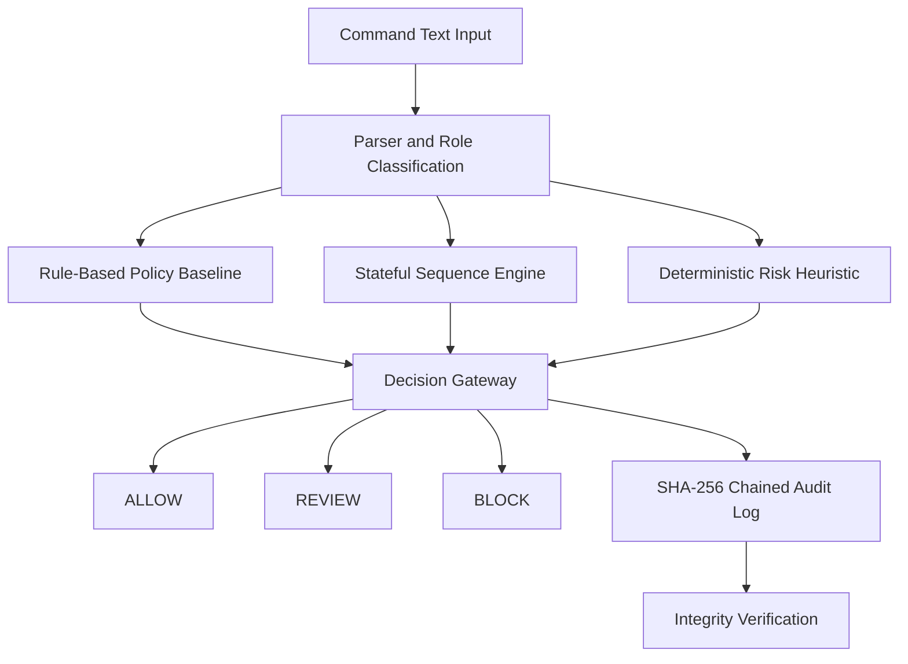

# TermiCipher-Z

### Explainable Command-Risk Analysis on IBM LinuxONE

**IBM Z Datathon 2026 · AI Secured: Innovation Without Exposure · SSF2026**

TermiCipher-Z is a controlled, user-space cybersecurity prototype that analyzes command patterns and event sequences to identify potentially risky multi-step behavior. It combines rule-based policy checks, stateful sequence detection, a deterministic risk heuristic, and SHA-256 hash-chained audit records.

Rather than executing commands, TermiCipher-Z treats input as inert text and evaluates its security implications through an explainable analysis pipeline.

---

## Overview

Individual commands may appear harmless when examined in isolation, while their ordering across a sequence can reveal a potentially risky workflow.

TermiCipher-Z explores this problem using a representative sequence:

```text
SENSITIVE_READ
      |
      v
  STAGE_DATA
      |
      v
OUTBOUND_TRANSFER
      |
      v
Potentially risky sequence
```

The prototype tracks classified events and evaluates their order against a predefined policy. Its objective is to demonstrate how transparent, sequence-aware analysis can complement individual command checks.

## Key Features

- **Rule-based analysis:** Parses supported command text and assigns security-relevant roles.
- **Stateful sequence detection:** Tracks event order and identifies configured multi-step patterns.
- **Deterministic risk heuristic:** Provides an additional, explainable risk signal without relying on a trained ML model.
- **Decision gateway:** Combines analysis results into `ALLOW`, `REVIEW`, or `BLOCK` decisions.
- **Audit-log integrity verification:** Links audit records using SHA-256 hashes and checks for modifications or chain inconsistencies.
- **Bounded event history:** Limits sequence-engine history to a fixed number of events.
- **LinuxONE validation:** Runs the Python implementation and automated tests on IBM LinuxONE Community Cloud.

## Architecture



**Execution boundary:** Input is analyzed as inert text. The prototype does not execute operating-system commands.

## How It Works

### 1. Parse and classify

Supported input is parsed into security-relevant roles. Unsupported syntax is handled conservatively rather than being treated as a successful parse.

### 2. Evaluate policy

The rule-based baseline examines individual commands, while the sequence engine tracks relevant events across a session.

### 3. Detect suspicious sequences

The sequence engine looks for the ordered pattern:

`SENSITIVE_READ → STAGE_DATA → OUTBOUND_TRANSFER`

It tolerates up to two `OTHER` events between expected steps. A third consecutive `OTHER` event resets partial progress.

### 4. Combine decisions

The gateway combines the baseline, sequence analysis, and heuristic signal. Depending on the results, the prototype can allow a request, flag it for review, or block it within the simulated decision workflow.

### 5. Verify audit integrity

Audit records are connected through SHA-256 hashes. The verifier checks record integrity and chain consistency to detect modifications and certain forms of record removal or reordering.

Hash chaining is an integrity-checking mechanism, not a guarantee of tamper-proof storage.

## Technology Stack

| Component | Technology |
|---|---|
| Implementation | Python |
| Parsing and policy | Custom Python modules |
| Sequence detection | Stateful rule-based engine |
| Risk scoring | Deterministic heuristic |
| Audit integrity | SHA-256 hash chaining |
| Testing | Python `unittest` |
| Execution environment | IBM LinuxONE Community Cloud |
| Operating system | Ubuntu 24.04 |
| Architecture | s390x |
| Python version tested | 3.12 |

## Project Structure

```text
Cyvra-SS2026/
├── src/
│   ├── gateway.py
│   ├── parser_policy.py
│   ├── sequence_engine.py
│   ├── ml_detector.py
│   └── audit_eval.py
├── tests/
├── fixtures/
│   ├── role_sequences.jsonl
│   └── role_sequences_extended.jsonl
├── docs/
│   ├── INTERFACES.md
│   ├── LIMITATIONS.md
│   └── PLATFORM_EVIDENCE.md
└── results/
    └── platform_evidence/
        ├── 01_environment.png
        ├── 02_versions.png
        ├── 03_tests_passed.png
        └── 04_synthetic_evaluation.png
```

## Getting Started

### Prerequisites

- Python 3.12 or a compatible Python version.
- Git.
- A Linux or Windows development environment.

### Clone the repository

```bash
git clone https://github.com/diyasajin327/Cyvra-SS2026.git
cd Cyvra-SS2026
```

### Run the automated test suite

```bash
python3 -m unittest discover -s tests -v
```

On Windows PowerShell, use:

```powershell
python -m unittest discover -s tests -v
```

The verified LinuxONE run completed with **58 tests passing, zero failures, zero errors, and zero skipped tests**.

### Run the synthetic evaluation

```bash
python3 -c "from src.audit_eval import evaluate_methods; import json; print(json.dumps(evaluate_methods('fixtures/role_sequences_extended.jsonl'), indent=2))"
```

This compares the configured methods on the supplied labelled synthetic traces.

## Evaluation

The extended fixture contains 20 labelled synthetic traces. The following results were observed in the initial in-sample comparison.

| Method | TP | FP | TN | FN | Precision | Recall |
|---|---:|---:|---:|---:|---:|---:|
| Role-pattern baseline | 7 | 4 | 9 | 0 | 63.6% | 100% |
| Sequence rules | 7 | 0 | 13 | 0 | 100% | 100% |
| Deterministic heuristic | 7 | 4 | 9 | 0 | 63.6% | 100% |
| Combined | 7 | 4 | 9 | 0 | 63.6% | 100% |

**Observed finding:** On this synthetic fixture, the sequence rules produced fewer false positives than the baseline.

**Important qualification:** These results are preliminary and in-sample. The extended fixture was designed around the detector's existing behavior, and independent held-out evaluation has not been established. The results must not be interpreted as evidence of generalization or real-world detection accuracy.

The heuristic is deterministic and rule-based; it is not a trained machine-learning model. Local latency measurements are exploratory and are not a comparative platform benchmark.

## IBM LinuxONE Validation

TermiCipher-Z was tested on:

- IBM LinuxONE Community Cloud
- Ubuntu 24.04
- s390x architecture
- Python 3.12

The automated test suite completed successfully with 58 passing tests.

### Platform Evidence

The repository includes screenshots documenting the environment, software versions, test results, and synthetic evaluation.

| Evidence | File |
|---|---|
| Environment | `results/platform_evidence/01_environment.png` |
| Software versions | `results/platform_evidence/02_versions.png` |
| Automated tests | `results/platform_evidence/03_tests_passed.png` |
| Synthetic evaluation | `results/platform_evidence/04_synthetic_evaluation.png` |

This demonstrates functional execution on LinuxONE. It does not establish a performance advantage over other architectures.

## Limitations and Future Work

TermiCipher-Z is an experimental prototype, not a production security enforcement system.

Current limitations include:

- Evaluation on a small synthetic dataset.
- No independently held-out evaluation.
- Limited parser coverage and static policy rules.
- A limited set of sequence patterns.
- In-memory session state without persistent session management.
- No system-wide command interception or enforcement.
- SHA-256 hash chaining without tamper-proof storage guarantees.
- A deterministic heuristic rather than a trained ML model.

Future work could include broader labelled datasets, independently held-out testing, additional sequence patterns, improved parser coverage, persistent session handling, and a documented operational performance evaluation.

## Security Boundary

TermiCipher-Z analyzes command text; it does not execute the supplied input.

It should not be treated as a replacement for operating-system access controls, endpoint detection, privileged audit infrastructure, or production security monitoring.

## Team and Challenge

**Project:** TermiCipher-Z  
**Event:** IBM Z Datathon 2026  
**Challenge:** AI Secured: Innovation Without Exposure  
**Identifier:** SSF2026

Repository: [Cyvra-SS2026](https://github.com/diyasajin327/Cyvra-SS2026)

---

*TermiCipher-Z — From isolated commands to explainable sequences.*
